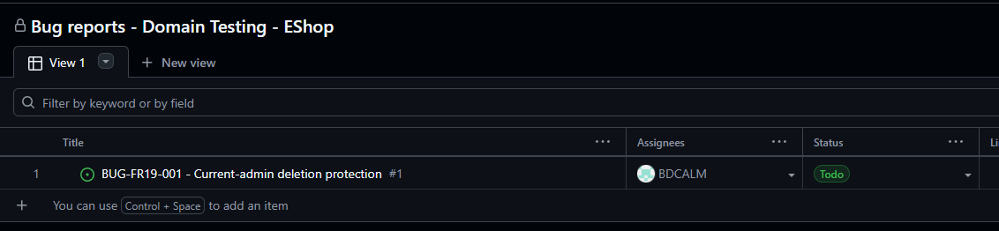
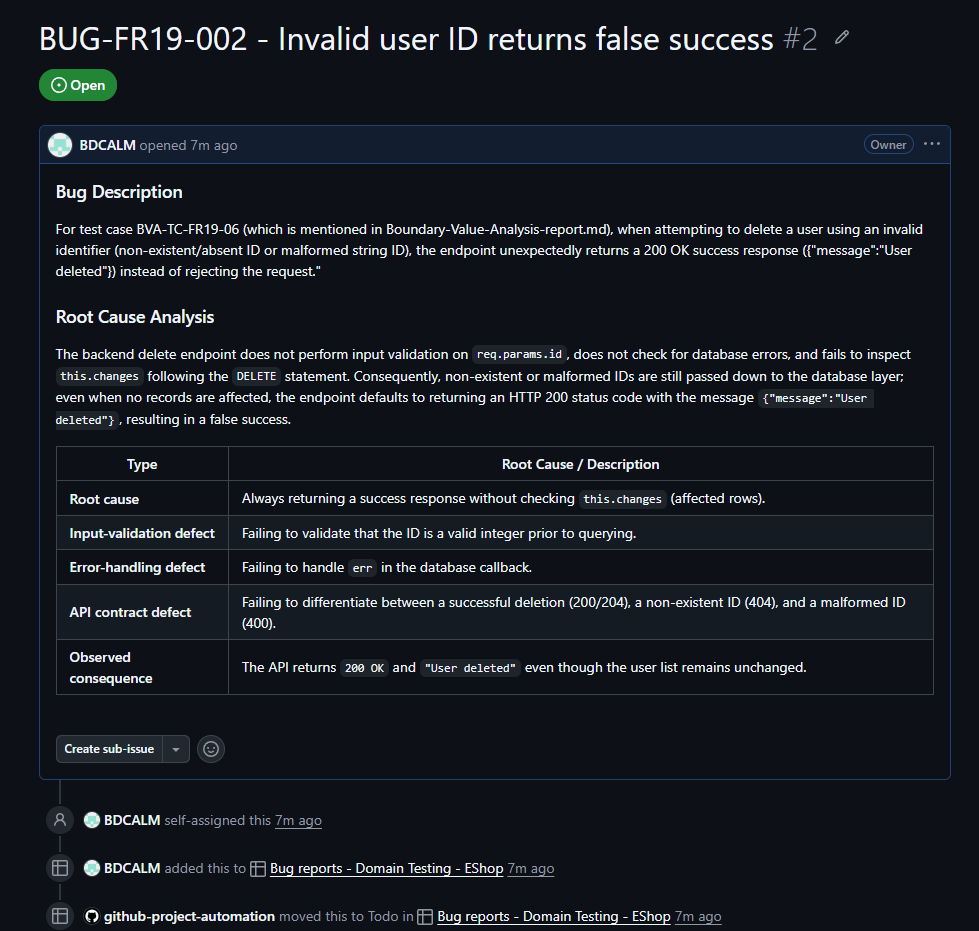

# Bug Report

> FR-19 findings below are based on student-supplied execution evidence.
> Bug Description and Root Cause Analysis remain student-owned sections.

## Summary

| Feature | Confirmed bugs |
| --- | ---: |
| FR-05 | 0 |
| FR-11 | 0 |
| FR-19 | 2 |
| FR-20 subsection | 0 |
| **Total** | **2** |

## Bug index

| Bug ID | Feature | Related test case(s) | Severity | Priority | Status | Evidence |
| --- | --- | --- | --- | --- | --- | --- |
| BUG-FR19-001 | FR-19 | TC-FR19-005 / BVA-TC-FR19-05 | High | High | Open | [FR-19-05-delAdminUserSuccessfully.png](./screenshots/FR-19/FR-19-05-delAdminUserSuccessfully.png) |
| BUG-FR19-002 | FR-19 | TC-FR19-006 / BVA-TC-FR19-06 | Low | Lơw|  Open | [FR-19-06-deleteInvalidUser.md](./screenshots/FR-19/FR-19-06-deleteInvalidUser.md) |

## BUG-FR19-001 - Current-admin deletion protection

| Field | Student entry |
| --- | --- |
| Feature | FR-19 - Admin user management |
| Related test case(s) | TC-FR19-005 / BVA-TC-FR19-05 |
| Date observed | 2026-10-20 |
| Environment/build/device | GitHub Codespaces forwarded admin frontend; student to add browser/device details |
| Preconditions | Authenticated admin session; current admin is visible in the user-management list |
| Test data | Current logged-in admin user ID |
| Severity | `High` |
| Priority | `High` |
| Status |  Open |

### Bug Description

The current admin (who are using the Frontend-admin web) can use delete-user feature for himself in the user-management UI. According to README.md (Feature Requirement - 19) that operation is forbidden.

### Steps to reproduce

 Step 1: Log in to a valid admin account (frontend-admin)
 Step 2: Click in "Users" in the left bar (for user management)
 Step 3: Click "Delete/Xóa" button in the current admin user (your admin account which is used by you)
 After the third step, the web shows the UI without the admin account (which is deleted),

### Expected result

The current logged-in administrator must not be deleted and must remain
protected according to FR-19. Student to refine wording against the approved
requirement.

### Actual result

The UI reported deletion success; after refresh the admin row was absent while
the existing admin session remained active.

### Evidence

- Screenshot: [FR-19-05-delAdminUserSuccessfully.png](./screenshots/FR-19/FR-19-05-delAdminUserSuccessfully.png)
- Related source/API evidence: API DELETE: /api/admin/users/:id (line 531 in backend/server.js)

### Root Cause Analysis

The backend admin-user deletion endpoint lacks a protection mechanism for the currently logged-in administrator. The endpoint merely validates the JWT and executes `DELETE FROM users WHERE id = ?` using the ID extracted from the URL, without verifying the user's role, comparing the target ID against `req.user.id`, or preventing the deletion of the active user. Furthermore, the stateless JWT continues to be accepted even after the administrator record has been deleted from the database because the authentication middleware only verifies the token's cryptographic signature without validating whether the user still exists in the database.

| Type | Description |
| --- | --- |
| **Root cause** | Missing validation check (`target user ID === current admin ID`) prior to executing the `DELETE` query. |
| **Contributing factor 1** | The endpoint does not verify `req.user.role`. |
| **Contributing factor 2** | The endpoint does not verify whether the target user actually exists. |
| **Contributing factor 3** | The endpoint does not verify `this.changes` (affected rows). |
| **Contributing factor 4** | The JWT middleware does not re-validate user existence against the database after token issuance. |
| **Contributing factor 5** | The frontend triggers the delete request and refreshes the user list without an active-admin UI guard. |

### Resolution and retest

| Item | Student entry |
| --- | --- |
| GitHub issue | https://github.com/BDCALM/Advanced-Web-Dev/issues/1 |

Screenshot for proof: 

## BUG-FR19-002 - Invalid user ID returns false success

| Field | Student entry |
| --- | --- |
| Feature | FR-19 - Admin user management |
| Related test case(s) | TC-FR19-006 / BVA-TC-FR19-06 |
| Date observed | 2026-10-20 |
| Environment/build/device | GitHub Codespaces forwarded backend/API; student to add browser/device details |
| Preconditions | Authenticated admin session; valid users with IDs 2, 4, and 5 were present before the requests |
| Test data | `999999`, `abc`, and `1abc`, sent one identifier per request |
| Severity | `Low` |
| Priority | `Low` |
| Status |  Open |

### Bug Description

For test case BVA-TC-FR19-06 (which is mentioned in Boundary-Value-Analysis-report.md), when attempting to delete a user using an invalid identifier (non-existent/absent ID or malformed string ID), the endpoint unexpectedly returns a 200 OK success response ({"message":"User deleted"}) instead of rejecting the request."

### Steps to reproduce

Step 1: Log in to a valid admin account and copy its token (token in search in "inspect" of the UI, find "Application" and click in "Local Storage")
Step 2: Open the terminal of Eshop project. Create "ADMIN_TOKEN" variable by the instruction: "ADMIN_TOKEN=<your_copied_token>"
Step 3: Create "BACKEND_URL="https://<your-github-codespace-domain>-3000.app.github.dev/api"" (if you're using github codespace to deploy local Backend server) or  "BACKEND_URL="https://localhost:3000/"" (if you're using your machine to deploy local Backend server)
Step 4: (Delete an Asbent user) Use this script in terminal to call to API (get all valid users) in order to check the number of original users"curl -i -sS \
  "$BACKEND_URL/admin/users" \
  -H "Authorization: Bearer $ADMIN_TOKEN""
Step 5: Use this script below to call to DELETE User (based on user:id) API to delete an asbent user: "curl -i -sS -X DELETE \t-for-HWork (main) $ curl -i -sS -X DELETE \
  "$BACKEND_URL/admin/users/999999" \
  -H "Authorization: Bearer $ADMIN_TOKEN""
  After this step, you will recieve an status code: "200" and a message "{"message":"User deleted"}"

Step 5: (Delete an invalid user from malformed id): Use this script below to call to DELETE User (based on user:id) API to delete an asbent user: "curl -i -sS -X DELETE \
  "$BACKEND_URL/admin/users/1abc" \
  -H "Authorization: Bearer $ADMIN_TOKEN""
 After this step, you will recieve an status code: "200" and a message "{"message":"User deleted"}"
Step 6: (Compare the current number of users and the previous numbers ) script: "curl -i -sS \ork (main) $ curl -i -sS \
  "$BACKEND_URL/admin/users" \
  -H "Authorization: Bearer $ADMIN_TOKEN""
  After this step, we obiviously see that the current users and previous users are the same (no one was deleted).

### Expected result

Invalid or absent identifiers must produce an error or a clearly defined
no-op without a false deletion-success response. Student to refine wording
against the approved requirement/API contract.

### Actual result

Each request returned HTTP `200` with
`{"message":"User deleted"}`; the valid user list remained unchanged.

### Evidence

- Script/API evidence: [FR-19-06-deleteInvalidUser.md](./screenshots/FR-19/FR-19-06-deleteInvalidUser.md)
- Related source/API evidence: API DELETE: /api/admin/users/:id (line 531 in backend/server.js)

### Root Cause Analysis

 The backend delete endpoint does not perform input validation on `req.params.id`, does not check for database errors, and fails to inspect `this.changes` following the `DELETE` statement. Consequently, non-existent or malformed IDs are still passed down to the database layer; even when no records are affected, the endpoint defaults to returning an HTTP 200 status code with the message `{"message":"User deleted"}`, resulting in a false success.

| Type | Root Cause / Description |
| --- | --- |
| **Root cause** | Always returning a success response without checking `this.changes` (affected rows). |
| **Input-validation defect** | Failing to validate that the ID is a valid integer prior to querying. |
| **Error-handling defect** | Failing to handle `err` in the database callback. |
| **API contract defect** | Failing to differentiate between a successful deletion (200/204), a non-existent ID (404), and a malformed ID (400). |
| **Observed consequence** | The API returns `200 OK` and `"User deleted"` even though the user list remains unchanged. |

### Resolution and retest

| Item | Student entry |
| --- | --- |
| GitHub issue | https://github.com/BDCALM/Advanced-Web-Dev/issues/2|

 Proof Screenshot: 

 