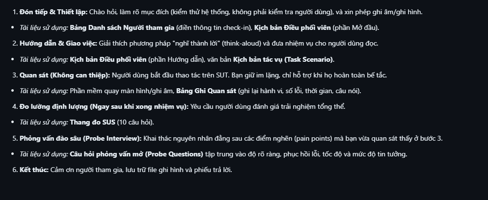

1. **Đón tiếp & Thiết lập:** Chào hỏi, làm rõ mục đích (kiểm thử hệ thống, không phải kiểm tra người dùng), và xin phép ghi âm/ghi hình.

* *Tài liệu sử dụng:* **Bảng Danh sách Người tham gia** (điền thông tin check-in), **Kịch bản Điều phối viên** (phần Mở đầu).

2. **Hướng dẫn & Giao việc:** Giải thích phương pháp "nghĩ thành lời" (think-aloud) và đưa nhiệm vụ cho người dùng đọc.

* *Tài liệu sử dụng:* **Kịch bản Điều phối viên** (phần Hướng dẫn), văn bản **Kịch bản tác vụ (Task Scenario)**.

3. **Quan sát (Không can thiệp):** Người dùng bắt đầu thao tác trên SUT. Bạn giữ im lặng, chỉ hỗ trợ khi họ hoàn toàn bế tắc.

* *Tài liệu sử dụng:* Phần mềm quay màn hình/ghi âm, **Bảng Ghi Quan sát** (ghi lại hành vi, số lỗi, thời gian, câu nói).

4. **Đo lường định lượng (Ngay sau khi xong nhiệm vụ):** Yêu cầu người dùng đánh giá trải nghiệm tổng thể.

* *Tài liệu sử dụng:* **Thang đo SUS** (10 câu hỏi).

5. **Phỏng vấn đào sâu (Probe Interview):** Khai thác nguyên nhân đằng sau các điểm nghẽn (pain points) mà bạn vừa quan sát thấy ở bước 3.

* *Tài liệu sử dụng:* **Câu hỏi phỏng vấn mở (Probe Questions)** tập trung vào độ rõ ràng, phục hồi lỗi, tốc độ và mức độ tin tưởng.

6. **Kết thúc:** Cảm ơn người tham gia, lưu trữ file ghi hình và phiếu trả lời.

# image

