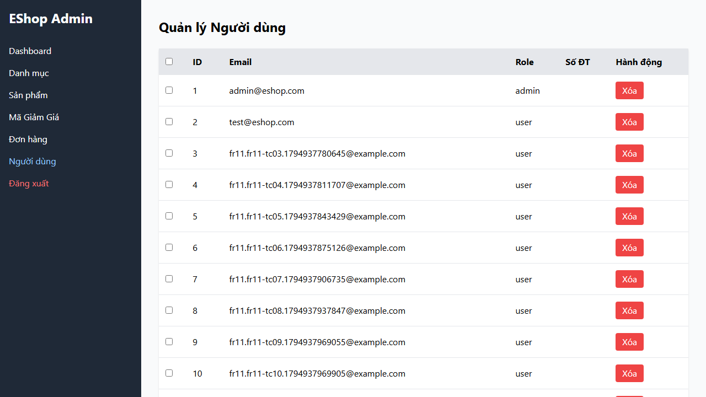

# GitHub Issue — BUG-FR19-001

## Title

[FR-19] Admin routes /api/admin/users accessible by regular users (missing role enforcement)

## Labels

`bug`, `security`, `critical`, `backend`

## Body

### Summary

`GET /api/admin/users` and `DELETE /api/admin/users/:id` only verify that a JWT token is present and valid, but do **not** check that the authenticated user holds the `admin` role. Any authenticated regular user can retrieve the full user list and delete any user account.

### Environment

- Backend: `http://localhost:3000` (Node.js / Express / SQLite)
- Affected endpoints: `GET /api/admin/users`, `DELETE /api/admin/users/:id`
- Reproduced on: Chromium, Firefox, WebKit (via Playwright FR19-TC02)
- Student ID: 23120242

### Steps to reproduce

1. `POST /api/login` with regular user credentials (`test@eshop.com` / `Test1234!`) → capture JWT token.
2. Send `GET http://localhost:3000/api/admin/users` with header `Authorization: Bearer <token>`.
3. Observe the response.

### Expected result

HTTP **403 Forbidden** — only users with `role = 'admin'` should be allowed.

### Actual result

HTTP **200 OK** with the complete user list (all emails, roles, login_attempts, shipping_addresses).

### Automated test evidence

- Test case: `FR19-TC02` in `HW4/tests/FR19.spec.js`
- Test data: `HW4/tests/data/FR19-data.json`
- Failure context: Playwright assertion `expect(page.getByRole('table')).not.toBeVisible()` failed because the user table is fully rendered with sensitive data.

### Evidence Screenshots & Attachments

**GitHub Repository Image URL (sau khi push lên repository):**


*(Hoặc kéo thả file ảnh cục bộ dưới đây vào khung soạn thảo GitHub Issue):*
- **Chromium:** `HW4/Submission/reports/playwright-html-minhchung/FR19/data/FR19-FR-19-Quản-lý-người-d-3cd77-nh-sách-người-dùng-quản-trị-chromium/test-failed-1.png`
- **Firefox:** `HW4/Submission/reports/playwright-html-minhchung/FR19/data/FR19-FR-19-Quản-lý-người-d-3cd77-nh-sách-người-dùng-quản-trị-firefox/test-failed-1.png`
- **WebKit:** `HW4/Submission/reports/playwright-html-minhchung/FR19/data/FR19-FR-19-Quản-lý-người-d-3cd77-nh-sách-người-dùng-quản-trị-webkit/test-failed-1.png`
- **Video đính kèm:** `HW4/Submission/reports/playwright-html-minhchung/FR19/data/FR19-FR-19-Quản-lý-người-d-3cd77-nh-sách-người-dùng-quản-trị-chromium/video.webm`

### Suspected root cause

`backend/server.js` line 522:
```javascript
app.get("/api/admin/users", authenticateToken, (req, res) => { ... })
```
The route uses only `authenticateToken` (JWT signature check). No role guard is applied.

### Suggested fix

Add a role guard middleware after `authenticateToken`:
```javascript
const adminOnly = (req, res, next) => {
  if (req.user.role !== 'admin') return res.status(403).json({ error: 'Forbidden' });
  next();
};
app.get("/api/admin/users", authenticateToken, adminOnly, (req, res) => { ... });
app.delete("/api/admin/users/:id", authenticateToken, adminOnly, (req, res) => { ... });
```

### Impact

- **Critical** — Full user data exfiltration by any authenticated user.
- Unauthorized mass account deletion possible.
- Violates FR-19 requirement: *"Chỉ admin mới được phép quản lý người dùng."*
