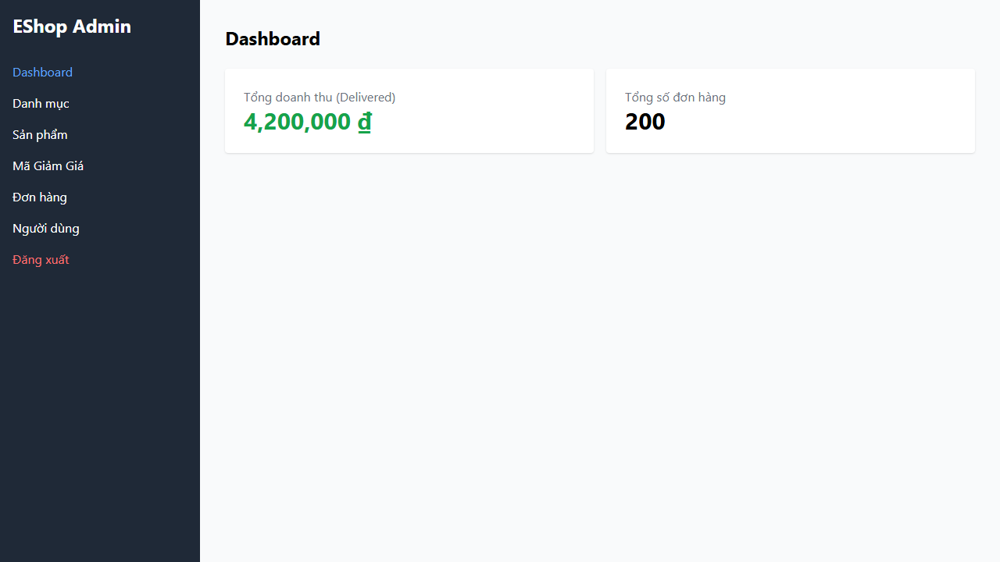

# GitHub Issue — BUG-FR19-003

## Title

[FR-19] PUT /api/users/me accepts client-supplied role field — allows privilege escalation to admin

## Labels

`bug`, `security`, `critical`, `backend`

## Body

### Summary

The `PUT /api/users/me` endpoint reads the `role` field from the request body and writes it directly into the database without any authorization check. Any authenticated regular user can self-promote their account to `admin` role in a single API call.

### Environment

- Backend: `http://localhost:3000`
- Affected endpoint: `PUT /api/users/me`
- Reproduced on: Chromium, Firefox, WebKit (via Playwright FR19-TC09)
- Student ID: 23120242

### Steps to reproduce

1. Register or use an existing regular user (`test@eshop.com` / `Test1234!`).
2. `POST /api/login` → capture JWT token (verify `role` is `"user"` via `GET /api/users/me`).
3. Send:
```
PUT http://localhost:3000/api/users/me
Authorization: Bearer <token>
Content-Type: application/json

{ "name": "Hacker", "role": "admin" }
```
4. Observe HTTP 200.
5. Send `GET /api/users/me` → observe `"role": "admin"`.

### Expected result

HTTP 200 but the `role` field is **silently ignored** — only `name`, `shipping_address`, and `phone` are updatable by the user themselves.

### Actual result

HTTP 200 and the user's `role` column in the database is updated to `"admin"`. The user now has admin privileges across all admin routes.

### Automated test evidence

- Test case: `FR19-TC09` in `HW4/tests/FR19.spec.js`
- Failure context: Playwright assertion `expect(page.locator('li', { hasText: 'Người dùng' })).not.toBeVisible()` failed because the user was successfully granted admin privileges and entered the Admin Dashboard.

### Evidence Screenshots & Attachments

**GitHub Repository Image URL (sau khi push lên repository):**


*(Hoặc kéo thả file ảnh cục bộ dưới đây vào khung soạn thảo GitHub Issue):*
- **Chromium:** `HW4/Submission/reports/playwright-html-minhchung/FR19/data/FR19-FR-19-Quản-lý-người-d-21b44--chối-truy-cập-Admin-Portal-chromium/test-failed-1.png`
- **Firefox:** `HW4/Submission/reports/playwright-html-minhchung/FR19/data/FR19-FR-19-Quản-lý-người-d-21b44--chối-truy-cập-Admin-Portal-firefox/test-failed-1.png`
- **WebKit:** `HW4/Submission/reports/playwright-html-minhchung/FR19/data/FR19-FR-19-Quản-lý-người-d-21b44--chối-truy-cập-Admin-Portal-webkit/test-failed-1.png`
- **Video đính kèm:** `HW4/Submission/reports/playwright-html-minhchung/FR19/data/FR19-FR-19-Quản-lý-người-d-21b44--chối-truy-cập-Admin-Portal-chromium/video.webm`

### Suspected root cause

`backend/server.js` lines 146-163:
```javascript
app.put("/api/users/me", authenticateToken, (req, res) => {
  const { name, shipping_address, phone, role } = req.body; // ← role extracted from body
  let query = "UPDATE users SET name = ?, shipping_address = ?, phone = ?";
  let params = [name, shipping_address, phone];
  if (role) {              // ← if attacker sends role, it gets written
    query += ", role = ?";
    params.push(role);
  }
  ...
});
```

### Suggested fix

Remove `role` from the destructuring entirely:
```javascript
const { name, shipping_address, phone } = req.body; // role removed
// Remove the if (role) block entirely
```

### Impact

- **Critical** — Privilege escalation from regular user to admin with a single unauthenticated API call.
- When combined with BUG-FR19-001, an escalated user can read all user data and delete any account.
- Violates the fundamental principle of least-privilege access control.
